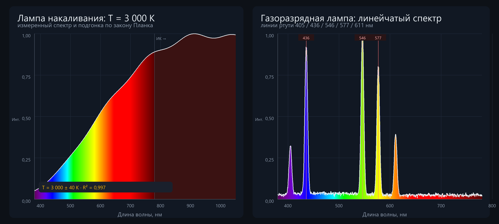

# СпектроЛаб

[](https://github.com/vetalek332-cell/spektrolab/actions/workflows/ci.yml)


**Учебный USB-спектрометр 340–1050 нм: конструкция, ПО и методичка.**
Дешёвый прибор для школ и вузов, который показывает настоящий спектр, измеряет температуру
по закону Планка и оформляет протокол лабораторной.



## Что это

SpektroLab — это два продукта в одном репозитории:

1. **Железо** — 3D-печатный USB-спектрометр (щель, коллиматор, решётка 600 штр/мм,
   камера без ИК-фильтра). Паспорт, BOM, OpenSCAD-модель и сборка — в [`hardware/`](hardware/README.md).
2. **ПО** — кроссплатформенное приложение и CLI на Python:
   спектр, калибровка, поиск линий, закон Планка, протоколы.

Ориентир по железу — массовые DIY-спектрометры класса «340–1050 нм» (Theremino и аналоги),
но у нас нормальное кросс-платформенное ПО, русская методичка, расчёт температуры
с погрешностью и воспроизводимые протоколы.

## Возможности

**Измерения**

- USB-камера → спектр 340–1050 нм (2048/1024 точки, зависит от настройки)
- авто-ROI спектральной полосы, тёмновой и опорный кадры, нормировка, сглаживание
- калибровка полиномом 1–3 степени по эталонным линиям, контроль RMS
- закон Планка: температура, доверительный интервал, R², RMSE
- законы Вина и Стефана — Больцмана
- поиск линий, FWHM, площадь, распознавание Hg / Na / Ne / H / He / Cd
- протокол: JSON, CSV (с кривой Планка), Markdown-отчёт
- симулятор прибора — работает без камеры и лампы

**Инженерия**

- ядро только на NumPy: без SciPy, OpenCV и GUI для CLI/тестов
- 60 unit-тестов + `spektrolab selftest`
- ленивые импорты GUI-зависимостей
- CLI и GUI используют одно ядро — физика не дублируется

## Быстрый старт

```bash
git clone https://github.com/vetalek332-cell/spektrolab.git
cd spektrolab

python -m venv .venv
# Windows: .venv\Scripts\activate
source .venv/bin/activate

pip install -e ".[gui]"      # numpy + PySide6 + matplotlib + OpenCV
spektrolab selftest          # проверить математику без камеры
spektrolab ui                # запустить приложение (демо-режим включён)
```

Если нужен только CLI/ядро:

```bash
pip install -e .
spektrolab selftest
```

## CLI

```bash
# Синтетический спектр лампы накаливания и подгонка температуры
spektrolab simulate --temperature 3000 --noise 0.01

# Анализ своего CSV (wavelength_nm;intensity) с поиском линий и протоколом
spektrolab analyze data.csv --peaks --element Hg --report protocol.md

# Калибровка по ртутной лампе
spektrolab calibrate --pixels 120 490 780 --wavelengths 435.83 546.07 611.60 --out calibration.json
spektrolab calibration-info calibration.json

# Линии в спектре
spektrolab peaks data.csv --element Hg --prominence 0.05
```

Пример вывода:

```
SpektroLab - синтетический спектр
=================================
Источник: чёрное тело 3000 К, 1024 точек, 340–1050 нм

Подгонка по закону Планка:
  Температура:   2999.8 ± 1.4 К
  R2:            0.9999
  RMSE:          0.0031
```

## Графический интерфейс

`spektrolab ui` (или `python -m spektrolab ui`). Вкладки:

- **Измерение** — кадр камеры, живой спектр, тёмновой/опорный кадры, подгонка Планка;
  по умолчанию включён **симулятор**, поэтому приложение запускается без железа.
- **Калибровка** — таблица «пиксель → длина волны», полином, RMS, сохранение в JSON.
- **Линии** — поиск и распознавание спектральных линий.
- **Протокол** — Markdown-отчёт и экспорт MD/JSON/CSV.

## Как это устроено

```
камера/симулятор → auto_roi → extract_spectrum → коррекции → калибровка (λ)
      → пики/линии → fit_planck (T ± ΔT, R²) → Measurement → JSON / CSV / Markdown
```

Подробности: [`docs/architecture.md`](docs/architecture.md),
[`docs/physics.md`](docs/physics.md).

## Железо

| Параметр | Значение |
|---|---|
| Диапазон | 340–1050 нм в ПО/калибровке; базовая версия 380–1050 нм (UV-версия — от 340 нм) |
| Оптическая схема | щель 0,03 мм → коллиматор f=40 мм → решётка 600 штр/мм → M12 f=6 мм (ось 25,5°) |
| Сенсор | 1920×1080, 1/2.9″, пиксель ≈2,8 мкм, без ИК-фильтра, ручной фокус |
| Дисперсия | 0,68 нм на пиксель (0,57–0,73 по диапазону), 1040 рабочих пикселей |
| Разрешение (FWHM) | ≈1,8 нм на 546 нм; 2,2 нм на 436 нм; 3,0 нм на 1050 нм |
| Интерфейс | USB 2.0, UVC (драйверы не нужны) |
| Корпус | PETG 3D-печать, 120×80×46 мм, ≈230 г, штативное гнездо 1/4″ |
| Цена | 9 900 ₽ (Home), 149 000 ₽ (Class, 15 приборов + методичка + обучение), UV — 12 900 ₽ |
| Себестоимость | BOM ≈4 400 ₽, полная ≈5 350 ₽ |

Полный паспорт, BOM, OpenSCAD-модель и инструкция по сборке — в [`hardware/README.md`](hardware/README.md).

## Структура репозитория

```
spektrolab/
├── src/spektrolab/          пакет: core, devices, ui, cli
├── tests/                   60 unit-тестов (unittest, numpy)
├── hardware/                конструкция: оптика, OpenSCAD, BOM, сборка
├── docs/                    архитектура, физика, планы
├── examples/                примеры использования
├── legacy/                  исходный прототип Beta.py (v0.1)
├── pyproject.toml           упаковка, зависимости, ruff/mypy
├── requirements.txt         ядро и CLI (numpy)
└── requirements-gui.txt     GUI-зависимости
```

## Тесты и качество

```bash
pip install -e .
PYTHONPATH=src python -m unittest discover -s tests -v   # 60 тестов
spektrolab selftest                                      # быстрая проверка на живой машине
```

CI гоняет тесты и самопроверку на Python 3.10/3.11/3.12 (Ubuntu, только numpy).

## Совместимость

- Python 3.10+; Windows, Linux, macOS.
- Ядро и CLI: только NumPy.
- GUI: PySide6, matplotlib, opencv-python (`pip install -e ".[gui]"`).
- Камера: любая UVC-камера, видимая OpenCV; рекомендуется 1920×1080 без ИК-фильтра.

## Документация

- [Архитектура](docs/architecture.md)
- [Физика и математика](docs/physics.md)
- [Планы развития](docs/roadmap.md)
- [История изменений](CHANGELOG.md)
- [Конструкция прибора](hardware/README.md)

## Лицензия

MIT — см. [LICENSE](LICENSE). Конструкция и ПО открыты: можно собирать, продавать и
дорабатывать, сохраняя упоминание проекта.
