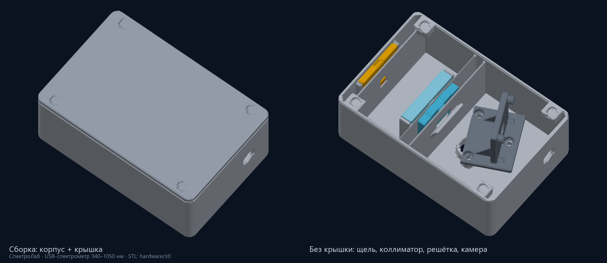
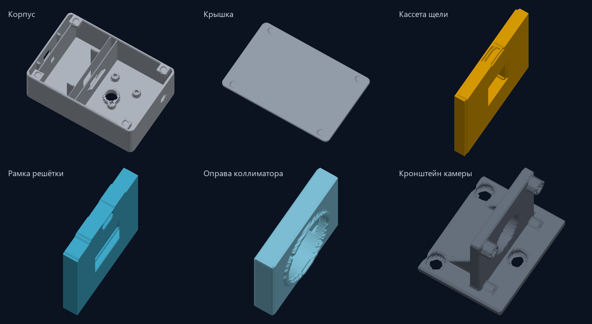

# 3D-модель «СпектроЛаб»

Здесь лежат превью печатной модели. Сами STL-файлы — в
[релизе v0.3.0](https://github.com/vetalek332-cell/spektrolab/releases/tag/v0.3.0)
(архив `spektrolab-stl.zip`): в git бинарники не хранятся, чтобы репозиторий
оставался лёгким.





## Состав модели

| Деталь | Размер, мм | Объём, см³ | Треугольников |
|---|---|---|---|
| Корпус | 120 × 80 × 43 | 65,5 | 295 188 |
| Крышка | 120 × 80 × 4,4 | 28,5 | 95 972 |
| Кассета щели | 4 × 34 × 34 | 4,1 | 21 828 |
| Рамка решётки | 5,6 × 34 × 35 | 3,7 | 33 076 |
| Оправа коллиматора | 9,1 × 40,6 × 34 | 7,0 | 65 508 |
| Кронштейн камеры | 32 × 40 × 34 | 7,3 | 44 024 |

Все шесть деталей — замкнутые многообразия (каждое ребро принадлежит ровно
двум треугольникам), поэтому слайсеры не ругаются на дыры. Объёмы посчитаны
по теореме о дивергенции и сверены с воксельной оценкой SDF.

## Как сгенерировать STL

Нужен только NumPy:

```bash
python hardware/cad/build_stl.py                 # все детали → hardware/stl/*.stl
python hardware/cad/build_stl.py --parts body    # одна деталь
python hardware/cad/build_stl.py --step 2.0      # быстрее и грубее
```

Скрипт печатает для каждой детали число треугольников, размер файла, замкнутость,
объём и габариты. Время генерации на ноутбуке — около 20 секунд.

Превью пересобираются так (нужен Pillow):

```bash
python hardware/cad/render_preview.py
```

## Как это сделано

`build_stl.py` не требует OpenSCAD: геометрия задана функциями расстояния (SDF,
как в `spektrolab_usb.scad`), поле сэмплируется на сетке 0,8–1,4 мм, поверхность
извлекается marching tetrahedra, вершины свариваются, ориентация треугольников
согласуется по рёбрам, мелкие дыры зашиваются. Затем пишется бинарный STL.

## Печать

- Материал: PETG, сопло 0,4 мм, слой 0,2 мм, 3 стенки, заполнение 25 %.
- Корпус — дном вниз, крышка — наружной стороной вверх, кронштейн камеры — основанием вниз.
- Поддержки: только под кронштейном камеры (наклонная пластина) и светоловушками.
- Закладные гайки M3/M2 запрессовываются паяльником при 220–240 °C.
- После печати проверьте посадочные места: кассета щели и рамка решётки должны
  входить в направляющие с зазором 0,2–0,3 мм.

## Отличия печатной версии от OpenSCAD

Модель адаптирована под FDM и немного отличается от параметрического исходника:

- светоловушки утолщены с 1,2 до 2,0 мм (тоньше сопла не печатается);
- кольцо-фиксатор линзы утолщено с 0,7 до 1,8 мм;
- убрана цековка 0,35 мм под фольгу — фольга приклеивается на плоскость кассеты;
- внутренние элементы входят в стенки и пол с нахлёстом 0,5 мм, чтобы не было
  касаний «в ноль» (из-за них на сетке появлялись дыры);
- окно щели расширено на 0,2 мм, чтобы убрать вырожденное пересечение.

Точная параметрическая геометрия — в `hardware/cad/spektrolab_usb.scad`.
