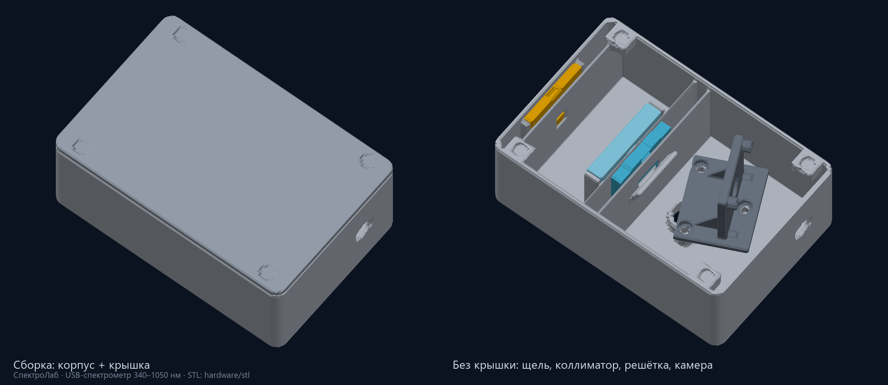

# СпектроЛаб — учебный USB-спектрометр

**Паспорт изделия.** Версия 1.0 · 2026-11-22 · репозиторий `spektrolab`, раздел `hardware/`.
Расчётная модель: `hardware/optics.py` (чистый Python + NumPy). Все числа в этом паспорте
воспроизводятся командой `python hardware/optics.py`.

**Одной строкой.** Настольный USB-спектрометр 380–1050 нм (UV-версия 340–1050 нм) за
9 900 ₽: щель, коллиматор, пропускающая голографическая решётка 600 штр/мм и камера
1920×1080 без ИК-фильтра в печатном корпусе 120×80×46 мм; ПО на Python строит спектр,
калибруется по линиям ртути, считает температуру по закону Планка и выдаёт протокол.

---

## 1. Назначение

Учебный спектрометр для школ, вузов, колледжей и кружков: лабораторные по тепловому
излучению и закону Планка, линейчатым и полосатым спектрам, закону Вина, спектрам
поглощения, температуре и яркости. Устройство рассчитано на работу «из коробки»:
подключается по USB, калибровка хранится в JSON, методичка и протоколы входят в комплект.

Отличие от DIY-аналогов класса Theremino ($75–95): не «набор с AliExpress», а серийное
изделие с повторяемой оптикой, допусками, приёмочными критериями, русской методичкой и
кросс-платформенным ПО.

---

## 2. Состав изделия и варианты поставки

| Вариант | Артикул | Цена | Что входит |
|---|---|---|---|
| **SpectroLab Home** | SL-H1 | **9 900 ₽** | Собранный и откалиброванный прибор, кабель USB, штативная гайка 1/4", паспорт, доступ к ПО и методичке |
| **SpectroLab Class** | SL-C15 | **149 000 ₽** | 15 приборов Home, печатные методички учителя, эталонный набор (ртутная лампа, натриевая лампа, светодиоды, кюветы), обучение (2 онлайн-сессии), гарантийный сервис |
| **SpectroLab UV** | SL-U1 | **12 900 ₽** | Прибор с кварцевой оптикой: диапазон 340–1050 нм, кварцевое окно щели, решётка на кварцевой подложке, модифицированное окно сенсора |

Прибор поставляется **собранным и откалиброванным**. Для кружков и проектной деятельности
доступна поставка тех же деталей в виде набора для самостоятельной сборки (BOM без
изменений, сборка по `assembly.md`); цена не меняется, калибровка выполняется по методике
из `assembly.md`.

Комплект поставки Home: прибор, кабель USB 2.0 (1,5 м, феррит), сменная щель 0,05 мм
(для слабых источников), ключ-шестигранник 2,5 мм, паспорт, QR-код на ПО и методичку.

---

## 3. Технические характеристики

| Параметр | Значение |
|---|---|
| Спектральный диапазон | **380–1050 нм** (базовая версия; UV-версия 340–1050 нм) |
| Диапазон калибровки и ПО | 340–1050 нм (задаётся калибровочным JSON) |
| Спектральное разрешение (FWHM) | **1,8 нм** на 546 нм; 2,0–2,2 нм (500–650 нм); 2,8–3,0 нм (850–1050 нм); 3,6 нм (380 нм); 5,5 нм (340 нм, UV-версия) |
| Шаг дискретизации | **0,68 нм/пиксель** средний (0,57–0,73 нм/px по диапазону), 1040 рабочих пикселей |
| Оптическая схема | щель → коллиматор f=40 мм → пропускающая решётка 600 штр/мм → M12 f=6 мм (ось 25,5° к нормали) → сенсор |
| Щель | 0,03 × 8 мм (стандарт), сменная 0,05 × 8 мм (опция для слабых источников) |
| Решётка | голографическая синусоидальная, 600 штр/мм, 25×25×3 мм, 1-й порядок |
| Коллиматор | плоско-выпуклая линза 25,4 мм, f=40 мм, BK7, апертурная диафрагма 4,0 мм |
| Камера | USB 2.0 UVC, 1920×1080, сенсор 1/2.9", пиксель 2,8 мкм, **без ИК-фильтра**, ручная фокусировка объектива |
| Интерфейс | USB 2.0, UVC (драйверы не нужны: Windows 10/11, Linux, macOS) |
| Питание | 5 В / ≤ 0,5 А по USB (2,5 Вт), внешнее питание не требуется |
| Габариты | **120 × 80 × 46 мм** (без кабеля), штативное гнездо 1/4"-20 |
| Масса | ≈ 250 г без кабеля, ≈ 290 г с кабелем |
| Материалы | PETG (корпус, держатели), стекло BK7 (коллиматор), нержавеющая фольга (щель), NdFeB (магниты), латунь (штативное гнездо) |
| Рабочие условия | +15…+35 °C, 20–80 % отн. влажности; хранение −20…+50 °C |
| Ресурс | крышка — не менее 1 000 циклов открытия (в приёмке — 100); камера не обслуживается |
| ПО | Python ≥ 3.10, NumPy; GUI на PySide6/OpenCV; калибровка полиномом 1–3 степени, тёмновой/опорный кадры, поиск линий, подгонка Планка (T, ΔT, R²), протоколы CSV/JSON/MD |

Разрешение и шаг дискретизации — расчётные величины (`optics.py`, раздел [4]); на прототипе
измеряются по FWHM линии Hg 546,07 нм и по центрам линий Hg, см. `assembly.md`.

---

## 4. Оптический тракт

```
 Вид сверху (ось X — оптическая ось, ось Y — направление дисперсии, Z — вертикаль)

        щель 0,03×8        коллиматор f=40     решётка 600 штр/мм        камера
        (x=-58)            (x=-18, Ø4)         (x=-10, нормально)        M12 f=6, 25,5°
          │                    │                     │                     │
  свет ──►│══ 4 мм ═══════════►│══ пучок 4 мм ══════►│                     │
          │                    │                     │╲ 1-й порядок        │
          │  8 мм по Z         │                     │ ╲ θ=11,8…39,0°      │
          │                    │                     │  ╲                   ▼
          │                    │                     │   ╲══════════════════════
          │                    │                     │    ╲    сенсор 5,376×3,024
          │                    │                     │     ╲    (1920×1080, 2,8 мкм)
          │                    │                     │ 0-й порядок
          │                    │                     └──────────► светоловушка
```

- Свет входит через щель, коллиматор формирует параллельный пучок, решётка дифрагирует
  его в первый порядок, объектив камеры (сфокусирован на бесконечность) строит изображение
  щели на сенсоре: каждой длине волны соответствует своя координата.
- Решётка стоит **нормально к пучку** (0°): θ(λ) = arcsin(λ/d), d = 1666,7 нм.
- Ось камеры наклонена на **25,5°** к нормали решётки: это середина диапазона по
  tg-координате (оптимум 25,41°), поэтому 340–1050 нм укладываются на сенсор симметрично,
  а 0-й порядок уходит мимо сенсора на −2,86 мм (за край 5,376/2 = 2,688 мм).
- Коллиматор — одиночная линза; чтобы её сферическая аберрация не съедала разрешение,
  перед линзой стоит печатная диафрагма 4,0 мм (f/10): аберрация падает с 94 мкм
  (при 12 мм) до 3,2 мкм, а светосила не теряется — зрачок объектива (3,0 мм) всё равно
  меньше диафрагмы (подробнее в 5.2).
- 0-й порядок проходит ниже оправы объектива (зазор 4,8 мм) и гасится светоловушкой
  на правой стенке; внутренние поверхности матовые чёрные.

---

## 5. Проверка и оптимизация расчётом

### 5.1. Проверка конфигурации из ТЗ (f = 3,6 мм)

Требовалось проверить: 1920 px × 2,8 мкм, f=3,6 мм, 600 штр/мм, 340–1050 нм — укладывается
ли в сенсор при разумной геометрии. **Укладывается**, но конфигурация не проходит по
качеству:

| Проверка | f = 3,6 мм (ТЗ) | f = 6,0 мм (принято) |
|---|---|---|
| Рабочих пикселей на диапазон | 624 (1,14 нм/px) | **1040 (0,68 нм/px)** |
| Изображение щели 0,03 мм | 0,96 px — **меньше 1,5 px** | **1,61 px** |
| 0-й порядок | −613 px, **попадает на сенсор** | −1022 px, вне сенсора |
| Свободный ход калибровки | 1,14 нм/px | 0,68 нм/px |
| FWHM 546 нм (расчёт) | 2,1 нм | **1,8 нм** |
| Отношение 577/579 (2,11 нм / FWHM) | 1,00 — двойник слит | **1,11 — двойник различим** |

Вывод: при f=3,6 мм диапазон формально помещается (используется 33 % сенсора), но линия
попадает на один пиксель, а недифрагированный 0-й порядок садится в кадр. Поэтому
**принят объектив f=6,0 мм**: 54 % сенсора, 0,68 нм/px, 0-й порядок вне сенсора.
Вариант f=8 мм тоже укладывается (1387 px), но требует зрачка 4 мм, а значит диафрагмы
коллиматора ≥6 мм (иначе виньетирование) — при этом сферическая аберрация растёт до
11 мкм и разрешение падает. f=6 мм — оптимум.

### 5.2. Принятые параметры и обоснование

| Параметр | ТЗ | Принято | Почему |
|---|---|---|---|
| Объектив камеры | f≈3,6 мм | **f=6,0 мм, f/2** | дискретизация 1,61 px, 1040 px, 0-й порядок вне сенсора, зрачок 3 мм |
| Щель | 0,05 мм | **0,03 мм** (+ опция 0,05) | FWHM 1,8 против 2,4 нм; без этого двойник Hg 577/579 сливается |
| Диафрагма коллиматора | не было | **4,0 мм** (f/10) | сферическая аберрация 3,2 мкм вместо 94 мкм при 12 мм; потери света нет — зрачок камеры 3 мм всё равно меньше |
| Наклон камеры | 25,5° | **25,5°** (оптимум 25,41°) | середина диапазона по tg-координате |
| Решётка | 600 штр/мм | **600 штр/мм** | больше 952 штр/мм не пропускает 1050 нм в 1-м порядке; меньше — падает дисперсия |
| Коллиматор | f≈40 мм | **f=40 мм, BK7** | компоновка 120 мм, доступная линза; хроматизм одиночной линзы учтён в допусках |
| Корпус | 120×80×45 | **120×80×46** | резерв под кровать камеры и кабель |

Влияние диафрагмы коллиматора (расчёт трассировкой лучей, BK7, 546 нм):

| Диафрагма | f/# | Сферическая аберрация (макс.) | Вывод |
|---|---|---|---|
| 12,0 мм | f/3,3 | 94,5 мкм | недопустимо |
| 6,0 мм | f/6,7 | 11,1 мкм | плохо |
| 4,5 мм | f/8,9 | 4,6 мкм | приемлемо |
| **4,0 мм** | **f/10** | **3,2 мкм** | **принято** |
| 3,0 мм | f/13,3 | 1,4 мкм | света меньше, поле уже |

### 5.3. Дисперсия и покрытие сенсора

| λ, нм | θ, ° | x на сенсоре, мм | пиксель | нм/px |
|---|---|---|---|---|
| 340 | 11,77 | −1,466 | 436 | 0,719 |
| 380 | 13,18 | −1,310 | 492 | 0,723 |
| 404,66 | 14,05 | −1,215 | 526 | 0,725 |
| 435,83 | 15,16 | −1,095 | 569 | 0,727 |
| 546,07 | 19,13 | −0,670 | 720 | 0,726 |
| 576,96 | 20,25 | −0,551 | 763 | 0,724 |
| 611,60 | 21,53 | −0,417 | 811 | 0,720 |
| 850 | 30,66 | +0,542 | 1153 | 0,664 |
| 1050 | 39,05 | +1,446 | 1476 | 0,571 |

Угловая дисперсия на 546 нм — 0,0364 °/нм, линейная — 3,86 мкм/нм. Рабочий диапазон
занимает пиксели **436…1476** (1040 px, 54 % сенсора), запас до краёв 1,22 и 1,24 мм
(436 px) — он расходуется на допуски установки. Полный сенсор геометрически покрывает
≈40–1270 нм; рабочая граница 1050 нм задана квантовой эффективностью кремния и ПО.

### 5.4. Разрешение

Суммарная FWHM линии складывается из щели, сферической аберрации коллиматора, хроматизма
одиночной линзы, PSF объектива (принято 3 мкм, уточняется на прототипе) и дифракции:

| λ, нм | щель, нм | дифр. предел, нм | шаг, нм/px | хроматизм, мкм | **FWHM, нм** |
|---|---|---|---|---|---|
| 340 (UV) | 1,22 | 0,14 | 0,719 | 19,4 | 5,5 |
| 380 | 1,22 | 0,16 | 0,723 | 11,8 | 3,6 |
| 404,66 | 1,21 | 0,17 | 0,725 | 8,5 | 2,9 |
| 435,83 | 1,21 | 0,18 | 0,727 | 5,2 | 2,2 |
| **546,07** | **1,18** | **0,23** | **0,726** | **1,9** | **1,8** |
| 576,96 | 1,17 | 0,24 | 0,724 | 3,2 | 1,9 |
| 611,60 | 1,16 | 0,26 | 0,720 | 4,4 | 2,0 |
| 850 | 1,08 | 0,35 | 0,664 | 9,4 | 2,8 |
| 1050 | 0,97 | 0,44 | 0,571 | 11,8 | 3,0 |

Изображение щели на сенсоре 4,5 мкм = 1,61 px; высота полосы 1,20 мм = 429 строк.
Фокусировка балансируется по 380 и 1050 нм (смещение плоскости сенсора −3,9 мкм от f):
в видимой области разрешение 1,8–2,2 нм, к краям падает из-за хроматизма одиночной линзы.
Двойник Hg 577,0/579,1 нм (2,11 нм) при FWHM(577)=1,9 нм даёт отношение 1,11 — линии
разрешаются (провал ≈10–14 %), это приёмочный тест оптики.

Пиксель не является пределом: шаг 0,57–0,73 нм/px, центроид линии определяется точнее
пикселя; реальное разрешение задаётся оптикой (1,8–3,0 нм), а не сенсором.

### 5.5. Допуски изготовления и юстировки

| Допуск | Влияние (расчёт) | Требование |
|---|---|---|
| Наклон камеры ±0,5° | сдвиг полосы 19 px, кажущийся сдвиг λ 13,7 нм | < 436 px запаса; поглощается калибровкой |
| Поворот решётки ±1° (рыскание) | сдвиг λ 27,5 нм = 38 px | < 436 px; поглощается калибровкой |
| Наклон решётки ±0,3° (тангаж) | вертикальный сдвиг 120 px (полоса 429 px) | линии Hg горизонтальны |
| Крен решётки ±0,5° | наклон полосы 9 px на 1040 px | < 429 px |
| Продольная установка коллиматора ±0,2 мм | расфокусировка 2,3 мкм (щель 4,5 мкм) | печатный упор, допуск ±0,1 мм |
| Ширина щели ±0,004 мм | Δλ ±13 % | контроль дифракцией лазера |
| Фокусировка объектива ±5 мкм | кружок 2,5 мкм | по минимуму FWHM 546 нм, 1/100 оборота |
| Плотность решётки ±0,5 % | ошибка масштаба ±0,5 % | поглощается калибровкой |
| Температура ±10 K | дрейф шкалы 0,07 нм | < 0,5 нм (шкала задаётся решёткой, не PETG) |

### 5.6. Калибровка

Из-за tg-геометрии зависимость λ(px) нелинейна: полином 1-й степени даёт RMS 6,3 нм
(макс. 17,2 нм), 2-й — 1,6 нм (4,2 нм), **3-й — 0,07 нм (0,24 нм)**. Поэтому калибровка
выполняется полиномом 3-й степени не менее чем по 6 линиям ртути
(404,66 / 435,83 / 546,07 / 576,96 / 579,07 / 611,60 нм). Приёмочный критерий: RMS < 1 нм,
максимальная невязка < 2 нм. Это согласуется с ядром ПО (`src/spektrolab/core/calibration.py`).

---

## 6. Конструкция

- Корпус 120×80×46 мм, PETG, стенки 2 мм, печатные допуски 0,2 мм. Печатные детали
  (6 шт.): корпус, крышка, кассета щели, рамка решётки, оправа-прижим линзы, кронштейн
  камеры; штативное гнездо 1/4"-20 — латунная закладная.
- Крышка магнитная (8 магнитов NdFeB 6×2 мм), снимается без инструмента; на внутренней
  стороне — прижимные рёбра к кассете щели и рамке решётки.
- Крепёж M3 в термозакладных гайках; камера — на M2. Кабель USB выходит через заднюю
  стенку с ферритовым кольцом и стяжкой.
- Внутри: матовое чёрное покрытие, светоловушка 0-го порядка с наклонными рёбрами,
  апертурная диафрагма коллиматора — часть оправы линзы.
- Оптическая скамья: щель x=−58, коллиматор x=−18, решётка x=−9,5, передняя плоскость
  объектива — 32 мм от решётки по оси 25,5°; ось тракта смещена на y=−3 мм и z=+23 мм
  от центра корпуса, чтобы развести 0-й порядок и оправу объектива.
- Модель: `cad/spektrolab_usb.scad` (параметрическая, OpenSCAD), экспорт STL —
  `stl/README.md`, чертёж — `drawing.svg`.

---

## 7. Варианты и комплектация

- **Home** — прибор, кабель, сменная щель 0,05 мм, паспорт; 9 900 ₽.
- **Class** — 15 приборов, 15 печатных методичек, эталонный набор (ртутная лампа ДРШ/ЛЭС,
  натриевая лампа, набор светодиодов 405/450/520/635/940 нм, кюветы), обучение учителей,
  гарантийный сервис; 149 000 ₽ (≈ 9 900 ₽ за устройство с методичкой и обучением).
- **UV** — кварцевая линза, решётка на кварцевой подложке, кварцевое окно щели,
  модифицированное окно сенсора; диапазон 340–1050 нм; 12 900 ₽.

Сменные щели: 0,03 мм (стандарт, разрешение), 0,05 мм (слабые источники, больше света).
Замена щели — 1 минута, без разборки оптики.

---

## 8. Преимущества перед аналогами

| Решение | Цена | Русский язык | Методичка | Планк (T, ΔT, R²) | Протоколы | Повторяемость |
|---|---|---|---|---|---|---|
| Theremino-класс (DIY, $75–95) | ≈7–9 тыс. ₽ | нет | нет | нет/скрипты | нет | зависит от сборки |
| Учебный спектрофотометр (приказ № 838) | 110–235 тыс. ₽ | да | да | нет | нет | да |
| Мобильное приложение-спектрометр | 0 ₽ | частично | нет | нет | нет | нет |
| **СпектроЛаб** | **9 900 / 149 000** | **да** | **да** | **да** | **CSV/JSON/MD** | **задана допусками и калибровкой** |

Ключевые отличия: кросс-платформенное ПО на Python (не привязка к Windows-утилите),
калибровка по линиям с контролем RMS, подгонка Планка без SciPy, русская методичка и
протокол опыта, воспроизводимая конструкция (STL + BOM + допуски) и цена на порядок
ниже школьного спектрофотометра.

---

## 9. Ограничения и допущения (честно)

1. **Разрешение непостоянно по диапазону**: 1,8 нм на 546 нм, 2,2 нм на 436 нм,
   2,8–3,0 нм на 850–1050 нм, 3,6 нм на 380 нм, 5,5 нм на 340 нм (UV). Причины —
   хроматизм одиночной коллимирующей линзы (смещение фокуса ≈2 мм по диапазону),
   PSF дешёвого M12-объектива и сферическая аберрация.
2. **Дискретизация**: шаг 0,57–0,73 нм/px; центроид линии определяется точнее пикселя
   (≈0,1–0,2 px при SNR > 100), поэтому шкала точнее «1 нм на пиксель», но реальное
   разрешение задаёт оптика (1,8–3,0 нм), а не сенсор.
3. **Виньетирование по высоте щели**: полностью освещено ±0,5 мм из ±4 мм, частично —
   до ±3,5 мм; эффективная высота щели 3,6 мм, полосы — 0,55 мм (≈195 строк) из 429.
   Края строк темнее; ПО выбирает ROI по яркости. Причина — диафрагма коллиматора,
   необходимая для разрешения.
4. **Дисторсия объектива** (до ≈1–2 % на краях поля) и нелинейность tg-геометрии
   компенсируются полиномом калибровки 3-й степени; без калибровки шкала неверна.
5. **1000+ нм**: квантовая эффективность кремния падает до ≈5–10 %, чувствительность
   низкая; нужны выдержка до 1–2 с, накопление строк, мощный источник. Стекло сенсора
   и объектива может ограничить 1050–1100 нм.
6. **УФ режется стеклом**: базовая версия — BK7 и стекло сенсора, диапазон от 380 нм.
   Версия UV требует кварцевой линзы, кварцевой подложки решётки, кварцевого окна щели
   и модификации окна сенсора; разрешение на 340 нм ≈5,5 нм.
7. **Порядки дифракции**: 2-й порядок 340 нм геометрически совпадает с 680 нм 1-го;
   синусоидальная голограмма подавляет чётные порядки, но на прототипе обязателен тест
   по светодиоду 450 нм (см. чек-лист).
8. **0-й порядок и рассеянный свет**: недифрагированный пучок уходит мимо сенсора и
   гасится светоловушкой; загрязнение щели/решётки даёт вуаль — протирать нельзя,
   решётка и щель меняются как модули.
9. **Абсолютная фотометрия не гарантируется**: прибор учебный, измерения относительные;
   температура по Планку — по форме спектра с ΔT и R², а не метрологическая поверка.
10. **Камера**: нужен модуль с ручной экспозицией/усилением и без ИК-фильтра; с
    автоэкспозицией подгонка Планка не сходится. Дешёвые модули различаются по шуму и
    «hot pixels» — тёмновой кадр обязателен.
11. **Механика**: PETG ползёт при >50 °C, магниты требуют единой полярности; после
    падения проверяется юстировка (линии Hg должны быть вертикальны и остры).
12. **Двойник 577/579 на пределе**: расчётное отношение 1,11; при PSF объектива хуже
    расчётной (3 мкм) линии сливаются — тогда меняется щель на 0,03 мм (стандарт) или
    проверяется фокус; это не «брак», а граница разрешения схемы.

---

## 10. Себестоимость и цены

Материалы — `bom.csv` (15 позиций, итог **4 400 ₽** на устройство). Полная себестоимость
с трудом (≈1 ч сборки) и логистикой ≈ **5 350 ₽**; упаковка входит в BOM.

| Позиция | Материалы | Полная себестоимость | Цена | Валовая маржа |
|---|---|---|---|---|
| Home (B2C) | 4 400 ₽ | ≈5 350 ₽ | **9 900 ₽** | ≈46 % |
| Class, 15 приборов + методички + эталонный набор + обучение | 15×4 400 = 66 000 ₽ | ≈104 000 ₽ | **149 000 ₽** | ≈30 % |
| UV | ≈5 800 ₽ (кварц: линза, решётка, окно щели, окно сенсора) | ≈6 750 ₽ | **12 900 ₽** | ≈48 % |

Структура себестоимости Home: камера и объектив — 1 900 ₽ (43 %), решётка — 780 ₽ (18 %),
оптика коллиматора — 320 ₽ (7 %), механика, крепёж и печать — 1 010 ₽ (23 %), кабель —
110 ₽ (2,5 %), упаковка и документация — 280 ₽ (6 %). Каналы: прямые продажи школам («Точки роста», «Кванториумы»),
маркетплейсы, учительские сообщества, вузы; B2B-комплект продаётся с обучением.

---

## 11. Чек-лист прототипа

Что обязательно проверить на первых 3–5 образцах (числа — расчётные, подлежат измерению):

- [ ] **Геометрия**: полоса на сенсоре в пикселях 436…1476 ±20 px; 0-й порядок вне сенсора; линии вертикальны.
- [ ] **Щель**: ширина по дифракции лазера (0,03 ± 0,004 мм), просвет ровный, без заусенцев.
- [ ] **Фокус объектива**: FWHM Hg 546,07 ≤ 2,2 нм; фиксация резьбы; повторяемость после транспортировки.
- [ ] **Калибровка Hg**: RMS < 1 нм (цель < 0,5 нм), max < 2 нм, 6 линий; сохранить JSON.
- [ ] **Двойник 577/579**: два максимума (провал ≥ 5 %), положение ±0,5 нм.
- [ ] **Эффективность**: SNR ≥ 100 на линии 546 нм при выдержке ≤ 100 мс (лампа ДРШ); тёмновой шум.
- [ ] **Края диапазона**: 380 нм (линия Hg 404,66 видна), 1050 нм (лампа накаливания, выдержка 1 с).
- [ ] **Порядки**: светодиод 450 нм не даёт ложного пика на 900 нм (подавление 2-го порядка).
- [ ] **UV-версия**: ртутная линия 365 нм видна, FWHM ≤ 6 нм; сравнить с базовой (не видна).
- [ ] **Термостабильность**: дрейф положения линии 546 нм < 1 px за 30 мин и при +10 K.
- [ ] **ПО**: определение камеры на Windows/Linux/macOS, ручная экспозиция, ROI, калибровка, Планк R² > 0,99 на лампе накаливания.
- [ ] **Механика**: 100 циклов крышки, посадка щели/решётки без люфта, кабель не нагружает разъём.
- [ ] **Упаковка**: сброс с 0,8 м в упаковке — юстировка сохраняется.
- [ ] **Экономика**: фактическая себестоимость партии 50 шт против BOM (закупка, брак печати, отбраковка фольги).

---

## 12. Файлы и воспроизведение расчёта

| Файл | Назначение |
|---|---|
| `optics.py` | расчёт схемы: θ(λ), дисперсия, покрытие сенсора, разрешение, допуски, калибровочная кривизна |
| `README.md` | этот паспорт изделия |
| `bom.csv` | BOM на 1 устройство, итог 4 400 ₽ (разделитель `;`, UTF-8) |
| `assembly.md` | сборка, юстировка, калибровка по ртути, приёмка, типичные ошибки |
| `cad/spektrolab_usb.scad` | параметрическая модель корпуса и держателей (OpenSCAD) |
| `drawing.svg` | габаритный чертёж: вид сверху с ходами лучей, вид сбоку, размеры |
| `stl/README.md` | экспорт STL, ориентация деталей, режимы печати |
| `make_drawing.py` | генератор `drawing.svg` из тех же расчётных данных |

Проверка расчёта: `python hardware/optics.py` — печатает таблицы и вердикт
«ГЕОМЕТРИЯ СХОДИТСЯ» (код возврата 0). Проверка варианта ТЗ:
`python hardware/optics.py --focal-mm 3.6` — вердикт «НЕ СХОДИТСЯ» (дискретизация и
0-й порядок), что и обосновывает переход на f=6 мм.

---

## 3D-модель и STL

Печатная модель собирается без OpenSCAD скриптом `cad/build_stl.py`
(SDF + marching tetrahedra, только NumPy): 6 деталей, все замкнуты, объёмы
и габариты проверены. Готовые STL — в релизе v0.3.0, превью — в
[`3d/README.md`](3d/README.md).



